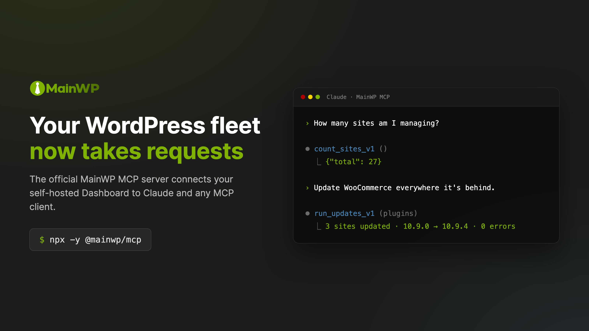

<p align="center">
  
</p>

<p align="center">
  <strong>Manage your whole WordPress network from Claude, Cursor, Codex, or VS Code through one local connection.</strong>
</p>

<p align="center">
  <a href="https://mainwp.com/mainwp-tools/mainwp-mcp/">Website</a> ·
  <a href="https://mainwp.com/mainwp-ai/">MainWP AI</a> ·
  <a href="https://docs.mainwp.com/mcp-server/overview">Documentation</a> ·
  <a href="https://docs.mainwp.com/mcp-server/quickstart">Quickstart</a> ·
  <a href="https://docs.mainwp.com/mcp-server/prompt-cookbook">Prompt Cookbook</a> ·
  <a href="https://www.youtube.com/watch?v=J3CIcbmImEQ">Video</a> ·
  <a href="https://community.mainwp.com/">Community</a> ·
  <a href="https://mainwpinvite.com/">Discord</a> ·
  <a href="https://mainwp.com/mainwp-support/">Support</a>
</p>

<p align="center">
  <a href="https://www.npmjs.com/package/@mainwp/mcp"></a>
  <a href="https://github.com/mainwp/mainwp-mcp/actions/workflows/ci.yml"></a>
  <a href="https://github.com/mainwp/mainwp-mcp/blob/main/LICENSE"></a>
</p>

# Official MainWP MCP Server

The MainWP MCP Server (`@mainwp/mcp`) connects Claude Code, Claude Desktop, Cursor, OpenAI Codex, VS Code Copilot, and other MCP-compatible AI tools to your self-hosted MainWP Dashboard. It is built for WordPress professionals and agencies who maintain client sites. One local connection reaches every WordPress site you manage, so you can ask in plain English:

> _"Which sites have pending plugin updates?"_
>
> _"Update WooCommerce everywhere it's behind."_
>
> _"Which client sites are disconnected right now?"_
>
> _"Check what we know about this client's sites before you plan updates."_

It runs locally on your computer beside your AI tool and connects straight to your Dashboard over HTTPS, with no MainWP service in between. Your client sites keep running the MainWP Child plugin they already have, with no extra plugins to install.

<p align="center">
  
</p>

## Stay in control of every change

Move faster across client sites while keeping every change under your control:

- **Previews and approval by default.** Updates, plugin and theme changes, and deletions show a preview first and run after you approve. Each approval covers that exact change and expires after five minutes. With pre-update backups turned on in MainWP Built-In Backups, update previews include each site's backup check.
- **Safe mode for testing and onboarding.** Safe mode blocks destructive tools while site syncing and update previews keep working, so new team members and new clients can explore freely.
- **Allow and block lists.** Choose which tools your assistant can see and call, including a ready-made read-only list in [Restrict Available Tools](https://docs.mainwp.com/mcp-server/guides/restrict-tools).
- **Knowledge before planning.** The server tells your assistant to load your Agency, Client, and Site Knowledge before it plans work, keeping update windows and held plugins in view.
- **Your credentials, your permissions.** The server signs in with a revocable WordPress Application Password and connects straight from your computer to your MainWP Dashboard over HTTPS. Every call runs under that WordPress user's permissions, including Team Control (MainWP Pro) roles granted `Use MainWP abilities and MCP`.

Full confirmation and security details: [Safety & Permissions](https://docs.mainwp.com/mcp-server/safety).

## What you can do

Your assistant gets over 100 tools from the free MainWP Core, plus tools from over 15 MainWP add-ons, discovered automatically when the add-on is active:

- **Sites:** list, count, sync, check connectivity, add, update, reconnect, suspend, or remove child sites
- **Updates:** inspect pending core, plugin, theme, and translation updates, manage ignored updates, and preview and apply updates on one site, a tag's sites, or your whole network
- **Plugins and themes:** inspect installed plugins and themes, spot abandoned ones, activate or deactivate plugins, switch themes, and delete what you have retired
- **Built-In Backups:** check backup status and history, run backups, manage backup tasks and storage destinations, and restore a site or roll a restore back
- **Clients, tags, and costs:** manage client records and tags, assign sites, and view client or site costs and upcoming renewals when Cost Tracker is active
- **Uptime and network activity:** check uptime stats and downtime incidents, query Network Activity logs and summaries, and inspect WordPress, PHP, and MySQL versions across your network
- **Knowledge:** read and manage Agency, Client, and Site Context, Skills, and Memory records
- **Guided workflows:** eight built-in MCP prompts for network summaries, maintenance checks, site reports, security audits, backup status, performance checks, troubleshooting, and update workflows

See [Tools & Resources](https://docs.mainwp.com/mcp-server/reference/tools) for tool naming and `mainwp://` inspection resources.

## Get started

### Pick your connection

MainWP gives you three free ways to work with AI on your sites. This package is the one that runs on your computer.

| Option                            | Best for                                                                                                                | How it connects                                                                                                                         |
| --------------------------------- | ----------------------------------------------------------------------------------------------------------------------- | --------------------------------------------------------------------------------------------------------------------------------------- |
| **Local server** _(this package)_ | Coding agents and desktop apps on your computer, private or VPN Dashboards, local safe mode, and the Claude Code plugin | Runs on your computer with a WordPress Application Password                                                                             |
| **Connect directly**              | claude.ai, ChatGPT, and other hosted apps, with no local install                                                        | OAuth 2.1 sign-in under **AI > MainWP MCP > Connect an app** ([Remote connections](https://docs.mainwp.com/mcp-server/remote/overview)) |
| **MainWP Assistant**              | MainWP answers (with no AI key) and site checks inside your Dashboard                                                   | **Assistant** in your Dashboard sidebar ([MainWP Assistant](https://docs.mainwp.com/dashboard/mainwp-assistant/overview))               |

### Requirements

- **MainWP Dashboard** on **WordPress 6.9+**, reachable over HTTPS. This page describes MainWP Dashboard 6.5; the [Quickstart](https://docs.mainwp.com/mcp-server/quickstart) lists what earlier versions support.
- **MainWP Child** on your client sites
- **Node.js 20.19+** and an MCP-compatible AI client

### Quickstart

In your MainWP Dashboard, open **AI > MainWP MCP > Local server** for guided setup that creates an Application Password and a ready-to-paste client config. To configure manually:

**1. Create an Application Password.** In your MainWP Dashboard, open **API Access > Application Passwords** (or **Users > Profile > Application Passwords** in WordPress admin), add one named "MainWP MCP Server", and copy it. A dedicated administrator account keeps your audit trail clean and lets you revoke access in one click.

**2. Add the server to your AI client.** For Claude Desktop, Cursor, and most MCP clients:

```json
{
  "mcpServers": {
    "mainwp": {
      "command": "npx",
      "args": ["-y", "@mainwp/mcp"],
      "env": {
        "MAINWP_URL": "https://your-dashboard.com",
        "MAINWP_USER": "admin",
        "MAINWP_APP_PASSWORD": "xxxx xxxx xxxx xxxx xxxx xxxx"
      }
    }
  }
}
```

**3. Restart your AI client and test.** Ask "List all my sites". A working setup returns your child sites by name and URL.

Client-specific config paths live in [Client setup](https://docs.mainwp.com/mcp-server/clients). All environment variables and `settings.json` options live in the [Configuration Reference](https://docs.mainwp.com/mcp-server/reference/configuration).

### Claude Code plugin and Claude Desktop bundle

**Claude Code:** the official plugin installs the MCP server, the `mainwp-dashboard` agent skill, and ten `/mainwp:*` workflow commands for setup, updates, maintenance checks, site reports, backups, security audits, and troubleshooting:

```text
/plugin marketplace add mainwp/mainwp-mcp
/plugin install mainwp@mainwp-mcp
```

The plugin reads your credentials from your shell environment. See the [Claude Code plugin guide](https://docs.mainwp.com/mcp-server/claude-code-plugin).

**Claude Desktop:** install the [`mainwp-mcp.mcpb` bundle](https://docs.mainwp.com/mcp-server/claude-desktop-bundle) from Claude Desktop Settings. You connect without editing `claude_desktop_config.json`, and your Application Password is stored in your operating system keychain.

## Documentation

Full guides live at **[docs.mainwp.com/mcp-server](https://docs.mainwp.com/mcp-server/overview)**:

- [Quickstart](https://docs.mainwp.com/mcp-server/quickstart): step-by-step walkthrough with screenshots
- [Remote connections](https://docs.mainwp.com/mcp-server/remote/overview): connect claude.ai, ChatGPT, and other apps directly to your MainWP Dashboard
- [Client setup](https://docs.mainwp.com/mcp-server/clients): Claude Desktop, Claude Code, Cursor, VS Code Copilot, OpenAI Codex, and more
- [Safety & Permissions](https://docs.mainwp.com/mcp-server/safety) and [Restrict Available Tools](https://docs.mainwp.com/mcp-server/guides/restrict-tools)
- [MainWP Knowledge](https://docs.mainwp.com/dashboard/overview/mainwp-knowledge) and [Prompt Cookbook](https://docs.mainwp.com/mcp-server/prompt-cookbook)
- [Configuration Reference](https://docs.mainwp.com/mcp-server/reference/configuration): environment variables, `settings.json`, and first-run chat setup
- [Tools & Resources](https://docs.mainwp.com/mcp-server/reference/tools), [Security Model](https://docs.mainwp.com/mcp-server/reference/security), and [Troubleshooting](https://docs.mainwp.com/mcp-server/troubleshooting)

## Community and support

- [MainWP Community](https://community.mainwp.com/) forum
- [Discord](https://mainwpinvite.com/)
- [MainWP Support](https://mainwp.com/mainwp-support/)

## Contributing

Bug reports and pull requests are welcome. Report security issues privately as described in [SECURITY.md](https://github.com/mainwp/mainwp-mcp/blob/main/SECURITY.md).

```bash
npm ci                 # install dependencies
npm run dev            # run from source
npm run inspect        # test with MCP Inspector
npm test               # run tests
npm run lint           # check code style
npm run format:check   # check formatting
npm run format         # fix formatting
```

CI runs format check, lint, typecheck, version check, plugin and skill sync checks, build, and tests on every pull request. When changing a configuration option, update the [docs-site configuration reference](https://docs.mainwp.com/mcp-server/reference/configuration) in the same change. `.agents/skills/mainwp-dashboard` is the canonical copy of the agent skill (shared with Codex CLI and other agent-skills clients); see [docs/plugin.md](https://github.com/mainwp/mainwp-mcp/blob/main/docs/plugin.md).

## License

GPL-3.0. MainWP MCP, MainWP Dashboard, MainWP Child, and MainWP Control are open source under the GPL. See [LICENSE](https://github.com/mainwp/mainwp-mcp/blob/main/LICENSE).
